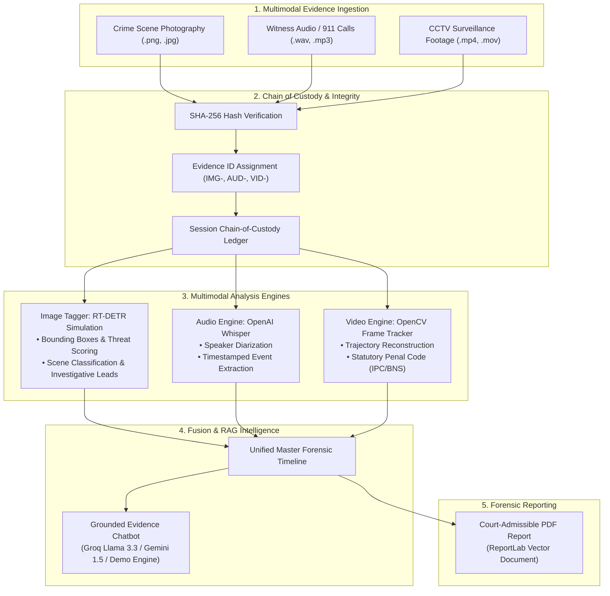

# 🔬 CrimeVision AI — Complete Technical & Project Documentation
**Intelligent Multimodal Forensic Analysis Platform**  
*NASSCOM FutureSkills — Skill Wallet Capstone Project 2*

---

## 📌 Executive Summary

**CrimeVision AI** is an automated forensic intelligence web platform designed to ingest, process, correlate, and cross-reference multimodal evidence—including **crime scene photography**, **witness audio statements / 911 dispatch calls**, and **CCTV surveillance footage**. 

Traditional forensic investigations often suffer from information silos: ballistic evidence, witness testimony, and surveillance videos are examined by separate units, leading to delayed investigative leads and coordination bottlenecks. **CrimeVision AI solves this by fusing multimodal evidence into a single chronological master timeline, backed by cryptographic chain-of-custody tracking, grounded zero-hallucination AI chat, and court-admissible PDF reporting.**

---

## 🏗️ System Architecture & Data Flow



---

## 📂 Project Directory Structure

```
nasscom/
├── app.py                      # Main entry point & Streamlit UI dashboard
├── utils.py                    # Chain of custody, cryptographic hashing, LLM callers & config
├── image_analysis.py           # Tab 1: RT-DETR visual object detection & threat classification
├── audio_analysis.py           # Tab 2: Speech-to-text, speaker diarization & audio timeline
├── video_analysis.py           # Tab 3: CCTV frame sampling, suspect trajectory & penal code mapping
├── fusion_chat.py              # Tab 4: Unified master timeline & Grounded RAG Chatbot
├── pdf_report.py               # Tab 5: Automated court-admissible PDF generation with ReportLab
├── sample_data.py              # 1-Click turnkey sample case generator (Synthetic vault burglary)
├── requirements.txt            # Python dependencies (Streamlit, Pillow, OpenCV, ReportLab, etc.)
├── packages.txt                # Linux system dependencies for Streamlit Cloud (libgl1, ffmpeg)
├── .streamlit/
│   └── config.toml             # Professional dark forensic UI theme styling
├── .gitignore                  # Git ignore rules
└── README.md                   # Project overview & quick start
```

---

## 🔍 Module-by-Module Technical Breakdown

### 1. Main Dashboard & State Management (`app.py` & `utils.py`)
- **Forensic Dark UI**: Built with custom CSS featuring a cybersecurity dark palette (`#0A0E17`, `#00E5FF`, `#162447`), custom metric cards, glowing badges, and responsive containers.
- **Session State Management**: Zero external database dependencies. The state of all ingested evidence, analysis records, timeline events, and chat conversations is maintained securely in `st.session_state`.
- **API Configuration & Dual-Mode Operation**:
  - **Live Mode**: Supports **Groq** (`llama-3.3-70b-versatile`, `llama-3.1-8b-instant`) and **Google Gemini** (`gemini-1.5-flash`).
  - **Demo Mode (Turnkey)**: Fully functioning offline mode using intelligent deterministic responses. Allows seamless testing without requiring any API keys.
- **Evidence Dashboard**: Real-time counter of total ingested evidence items categorized into Images, Audios, and Videos with an expandable Evidence Registry.

### 2. Tab 1: Crime Scene Visual Evidence Tagger (`image_analysis.py`)
- **RT-DETR Simulation**: Simulates Real-Time Detection Transformer object detection across 15 forensic categories (Persons, Handguns, Rifles, Knives, Blood Spatter, Forced Entry Points, Shell Casings, Footprints, etc.).
- **Spatial Bounding Boxes**: Draws colored bounding boxes, center crosshairs, and confidence percentages on the image using Pillow.
- **Threat Level Calculation**: Evaluates combined threat level (Low, Medium, High, Critical) using a weighted formula:
  $$\text{Threat Score} = \max(\text{Confidence}_i \times \text{ThreatWeight}_i)$$
- **Automated Scene Classification**: Classifies scene into categories like *Burglary / Breaking & Entering*, *Homicide*, *Armed Assault*, or *Drug Offense*.
- **Investigative Lead Generation**: Produces actionable, prioritized leads (e.g. biohazard collection, NIBIN ballistic matching, footwear casting).
- **AI Narrative Summary**: Generates a 2-3 paragraph professional case summary citing the evidence ID.

### 3. Tab 2: Witness Audio Transcription (`audio_analysis.py`)
- **Speech-to-Text Pipeline**:
  - Automatically attempts transcription with local **OpenAI Whisper** (`whisper.load_model("base")`).
  - Gracefully falls back to high-fidelity simulated 911 / witness transcripts if Whisper is not locally installed.
- **Speaker Diarization**: Tags segments by speaker (e.g., `Speaker-1 (Witness)`, `911 Dispatcher`) with exact start and end timestamps (`MM:SS`).
- **Chronological Event Extraction**: Automatically parses key forensic occurrences (e.g., gunshot sounds heard, vehicle departure, victim discovery) and registers them to the master ledger.

### 4. Tab 3: CCTV Video Analysis & Event Progression (`video_analysis.py`)
- **OpenCV Video Sampling**: Ingests surveillance video files (`.mp4`, `.avi`, `.mov`) and extracts evenly spaced keyframes using OpenCV (`cv2.VideoCapture`).
- **Suspect & Vehicle Trajectory Tracking**: Tracks suspect movement vectors across frames and renders an interactive **Plotly** coordinate graph showing spatial progression across the surveillance plane.
- **Statutory Penal Code Mapping**: Maps detected actions to legal statutes under both the **Indian Penal Code (IPC)** and the modern **Bharatiya Nyaya Sanhita (BNS)**:
  - *Trespassing / Breaking*: IPC §441-462 / BNS §329-§335
  - *Armed Robbery*: IPC §390-402 / BNS §304-§311
  - *Assault*: IPC §351-358 / BNS §130-§136
  - *Illegal Arms Possession*: Arms Act §25-§33

### 5. Tab 4: Multimodal Fusion & Grounded Evidence Chat (`fusion_chat.py`)
- **Master Forensic Ledger**: Ingests all timeline events registered across Tabs 1, 2, and 3, sorts them chronologically, and categorizes them by severity (Critical, High, Medium, Low).
- **Grounded RAG Chatbot**:
  - Employs strict zero-hallucination system prompt engineering.
  - Answers are strictly limited to the ingested evidence context.
  - Mandatory requirement for the model to cite Evidence IDs (e.g., `[IMG-DEMO8412]`, `[AUD-DEMO3194]`, `[VID-DEMO9521]`).
  - Works both in Live Mode (Groq / Gemini) and Demo Mode.

### 6. Tab 5: Automated Court-Admissible PDF Report (`pdf_report.py`)
- **ReportLab Vector PDF**: Generates a multi-page, formatted PDF document ready for submission in court or case review:
  1. **Cover & Case Metadata**: Case ID, Investigator name, classification label, timestamp.
  2. **Section 1: Chain of Custody Table**: SHA-256 hashes, status, timestamps, evidence IDs.
  3. **Section 2: Physical Evidence Table**: Detected objects, coordinates, confidence scores, investigative actions.
  4. **Section 3: Audio Transcription Log**: Full witness text, speaker-tagged segments, and key timestamps.
  5. **Section 4: CCTV Video Event Log**: Frame numbers, timestamps, legal penal codes, and model confidence.
  6. **Section 5: Master Integrated Timeline**: Unified chronological timeline across all evidence modalities.
  7. **Official Sign-Off & Legal Disclaimer**: Law enforcement sensitivity disclaimer and signature block.
- **Download Persistence**: Generated PDF bytes are preserved in session state so download buttons remain active across Streamlit reruns.

### 7. Turnkey 1-Click Demo Engine (`sample_data.py`)
- Generates a fully synthetic crime case (**Bank Vault Burglary & Armed Assault**):
  - **Image**: Programmatically drawn synthetic crime scene (broken window, room walls, floor tiles, yellow numbered cones, blood spatter pattern).
  - **Audio**: Detailed 911 emergency call with witness statement and timestamps.
  - **Video**: 8-frame surveillance alley sequence with tracked suspect trajectory.
  - **Initial Q&A**: Sample pre-computed cross-modal grounded answer.
- Allows any examiner or recruiter to test the complete platform with **zero uploads** and **zero configuration** in 1 second.

---

## 🔒 Forensic Integrity & Chain of Custody

Chain of custody is the cornerstone of forensic evidence admissibility under law (Section 65B of Indian Evidence Act / Section 63 of Bharatiya Sakshya Adhiniyam):

1. **Cryptographic Ingestion Hash**: Every uploaded file (image, audio, video) is immediately hashed using **SHA-256**:
   $$\text{Hash} = \text{SHA-256}(\text{Raw File Bytes})$$
2. **Forensic Evidence ID**: Generated dynamically using a unique prefix and 8-character hex token (`IMG-XXXXXXXX`, `AUD-XXXXXXXX`, `VID-XXXXXXXX`).
3. **Immutable Session Record**: The file name, hash, UTC timestamp, investigator name, and verification status are permanently attached to the record and printed on every report page.

---

## 🚀 Installation & Running Instructions

### Local Setup

```bash
# 1. Clone the repository
git clone <your-repo-url>
cd nasscom

# 2. Create and activate a Python virtual environment
python3 -m venv venv
source venv/bin/activate    # On Windows: venv\Scripts\activate

# 3. Install dependencies
pip install -r requirements.txt

# 4. Launch the Streamlit application
streamlit run app.py
```

### Streamlit Community Cloud Deployment

1. Push this repository to GitHub.
2. Sign in to [share.streamlit.io](https://share.streamlit.io).
3. Select your repository and configure:
   - **Main file path:** `app.py`
   - **Python version:** `3.10` or higher
4. Click **Deploy**. The included `packages.txt` (`libgl1`, `ffmpeg`) and `requirements.txt` ensure immediate dependency installation without errors.

---

## 🔑 API Keys Configuration

| Provider | Recommended Model | Key Format | Where to Obtain |
|---|---|---|---|
| **Groq (Free & Fast)** | `llama-3.3-70b-versatile` | `gsk_...` | [console.groq.com](https://console.groq.com) |
| **Google Gemini** | `gemini-1.5-flash` | `AIza...` | [aistudio.google.com](https://aistudio.google.com) |
| **Demo Mode** | *Built-in Offline Engine* | *None needed* | Pre-configured out of the box |

---

## 🎓 Expected Viva / Presentation Q&A

### Q1: What makes this platform multimodal?
> **Answer:** It fuses three distinct unstructured data streams—2D visual spatial data (scene photography), 1D temporal audio frequency data (witness statements), and 3D spatio-temporal video data (CCTV frames)—into a single unified chronological timeline and unified knowledge base.

### Q2: How does the application prevent LLM hallucinations during forensic interrogation?
> **Answer:** We enforce a Grounded RAG (Retrieval-Augmented Generation) paradigm. The prompt sent to the LLM injects the entire structured evidence context (detections, bounding box coordinates, witness statements, and frame logs) with strict system instructions prohibiting ungrounded assertions and mandating Evidence ID citations for every claim.

### Q3: Why is SHA-256 hashing included for each evidence item?
> **Answer:** In forensic science and court proceedings (Section 65B of Indian Evidence Act / Section 63 BSA), establishing that digital evidence has not been tampered with or altered since collection is mandatory. SHA-256 generates a unique 256-bit cryptographic digest of the raw bytes upon ingestion.

### Q4: Does the application require expensive GPU servers or complex databases to run?
> **Answer:** No. CrimeVision AI was architected for maximum portability. All state is maintained in Streamlit session memory, dependencies are lightweight (`opencv-python-headless`, `reportlab`, `plotly`), and a turnkey demo mode is provided so the entire system runs anywhere, including free Streamlit Community Cloud instances.

---

*CrimeVision AI — Built for NASSCOM FutureSkills Skill Wallet Program.*

